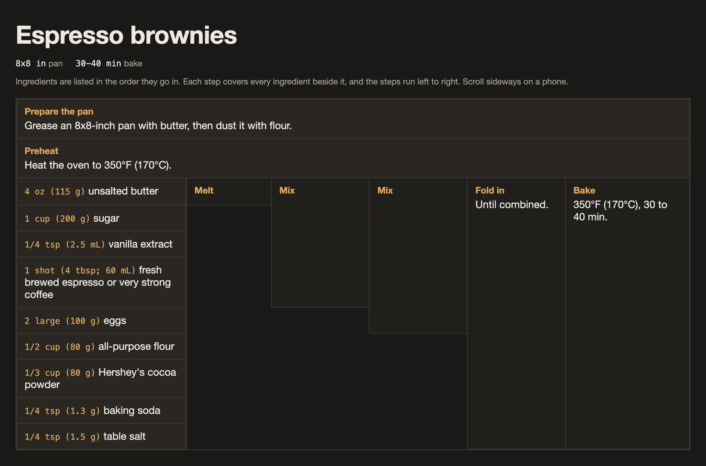

# algorithmic-recipe

Turn any recipe into a table you can actually cook from.

Ingredients are listed down the left in the order you add them. Each step sits to the right and stretches over everything already in the bowl, so you always see what is in the mixture and what comes next. Read it left to right like a program.



## Why it's useful

- **Mise en place in one glance.** The ingredient column is your prep list, already in the order you will need things.
- **Shopping list for free.** Everything with its quantity, in one column.
- **Quantities right where you need them.** Each step shows exactly which ingredients go into it, so there is no scrolling back and forth to the ingredient list while your hands are covered in batter.
- **Nothing lost in translation.** Every temperature, time, visual cue and "why" tip from the original is kept (reworded, not copied).
- **Works on a phone.** Light and dark mode, and the ingredient column stays pinned while the table scrolls sideways.

See [`examples/espresso-brownies.html`](examples/espresso-brownies.html) for the full page behind the screenshot above.

## Install

Ask your agent:

```
Install the algorithmic-recipe skill from https://github.com/CrisBarreiro/algorithmic-recipe, refer to the repo's AGENTS.md for instructions.
```

Or in Claude Code:

```bash
claude plugin marketplace add CrisBarreiro/algorithmic-recipe
claude plugin install algorithmic-recipe@algorithmic-recipe
```

See [INSTALL.md](INSTALL.md) for installing without the plugin system, on Claude.ai, and for updating or uninstalling.

## Usage

Invoke the skill and give it a recipe (pasted text, a URL or an attachment):

```
/algorithmic-recipe https://example.com/my-favourite-brownies
```

Claude also loads the skill on its own when you ask to "rewrite this recipe as an algorithmic recipe". The slash command just makes it explicit. The result is a single self-contained HTML page, saved wherever you ask.

## Repo layout

```
algorithmic-recipe/
├── README.md
├── INSTALL.md                every install route
├── AGENTS.md                 install guidance for agents
├── .claude-plugin/
│   ├── plugin.json           plugin manifest
│   └── marketplace.json      lets /plugin marketplace add point at this repo
├── skills/
│   └── algorithmic-recipe/
│       └── SKILL.md          the skill itself (what Claude loads)
├── examples/
│   └── espresso-brownies.html
└── assets/
    └── espresso-brownies.png screenshot used in this README
```
