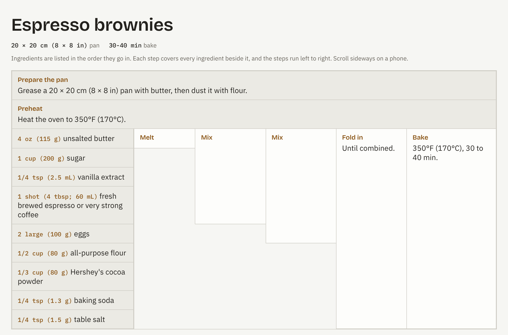
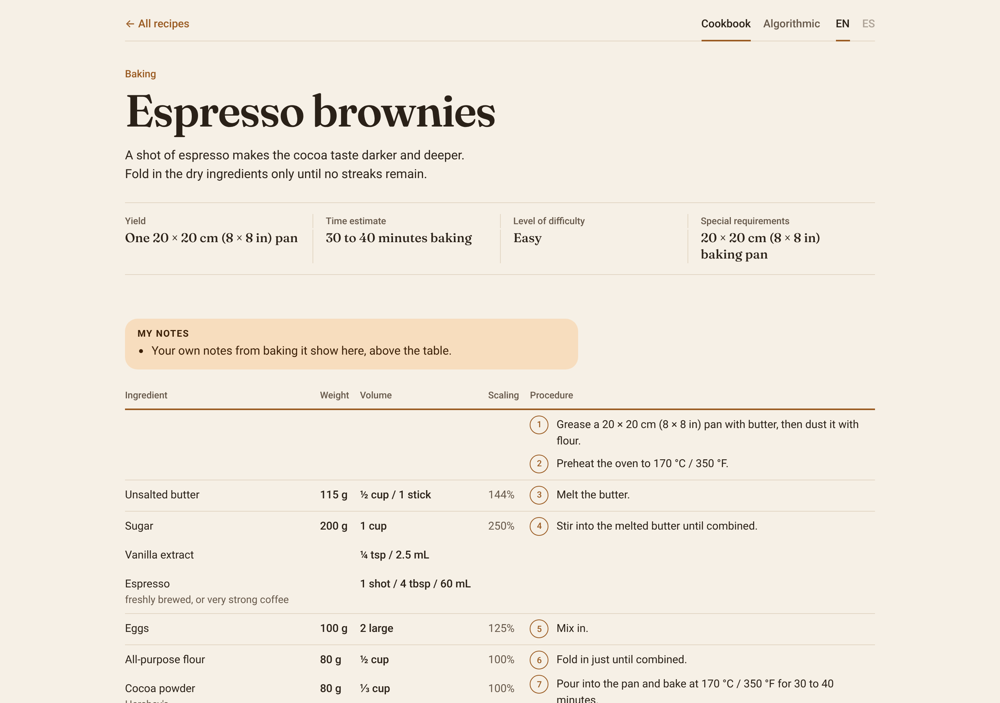

# baking-plugin

Turn any recipe into a page you can actually cook from, and make it gluten-free or dairy-free on the way.

Most recipes list every ingredient at the top and every step underneath, so you keep scrolling back up to find how much of what goes in now. Both layouts here fix that the same way: each step sits right beside the ingredients and quantities it uses, so you can see where you are and what goes in next. They just present it differently: one as an algorithmic grid, the other as a more human-friendly cookbook page.

The plugin has four skills that work together:

| Skill | What it does |
| --- | --- |
| `/algorithmic-recipe` | The algorithmic presentation: a staircase table where ingredients run in order of addition and each step spans everything already in the bowl. |
| `/cookbook-recipe` | The human-friendly presentation: a cookbook-style page with ingredients grouped by the step that adds them, with weight, volume and scaling %, beside numbered steps. |
| `/gluten-free-recipe` | Converts a recipe with gluten using Cris's rules, or swaps an unspecified gluten-free blend for her homemade one. |
| `/dairy-free-recipe` | Converts a recipe with dairy using Cris's rules. |

All four follow the same [shared rules](skills/_shared/recipe-rules.md): quantities stay in the source's units (only inches become centimetres), every tip and cue is kept, and pages print on landscape A4.

## Why the layouts work

- **Quantities right where you need them.** Each step shows exactly which ingredients go into it, so there is no scrolling back and forth while your hands are covered in batter.
- **Steps at a glance.** The structure shows where you are in the recipe and what comes next, without rereading paragraphs.
- **Mise en place in one go.** Ingredients are listed in the order you will need them, so the list doubles as your prep and shopping list.
- **Nothing lost in translation.** Every temperature, time, visual cue and "why" tip from the original is kept, reworded rather than copied.
- **Works on a phone and on paper.** Light and dark mode, phone-friendly layouts, and print styles for landscape A4.

## Algorithmic layout

Ingredients are listed down the left in the order you add them. Each step sits to the right and stretches over everything already in the bowl, so you always see what is in the mixture and what comes next. Read it left to right like a program. On a phone, the ingredient column stays pinned while the table scrolls sideways.



See the [full espresso brownies page](https://crisbarreiro.com/baking-plugin/examples/espresso-brownies.html) behind the screenshot above (source in [`examples/espresso-brownies.html`](examples/espresso-brownies.html)).

## Cookbook layout

The same step-by-step structure in a form that reads like a cookbook page. Ingredients are grouped by the step that adds them, and each group sits beside its numbered steps, so finding the quantities for the step you are on is still one glance away. Around it, a metadata block (yield, time, storage, difficulty, special requirements) and a short intro set the scene, and variations and make-ahead notes follow. Weights come first, with volumes alongside and a scaling percentage for each ingredient. On a phone, each group stacks its ingredients with its steps underneath.

<p>


</p>

Source in [`examples/espresso-brownies-cookbook.html`](examples/espresso-brownies-cookbook.html).

## Gluten-free and dairy-free conversion

`/gluten-free-recipe` converts a recipe that contains gluten using the rules in [`skills/gluten-free-recipe/rules.md`](skills/gluten-free-recipe/rules.md). It picks the rule set for the type of bake (brownies, butter cakes, sponges, cookies, pastry, pancakes, cheesecake), swaps in the homemade gluten-free flour blend, adds xanthan gum, adjusts fat and liquids, and lists every change. It also runs on recipes that are already gluten-free but call for an unspecified blend, swapping in the homemade one. Bread and other yeasted doughs are never converted: they don't adapt reliably by rules. It returns the converted recipe as text, so you can render it next.

`/dairy-free-recipe` does the same for dairy with the rules in [`skills/dairy-free-recipe/rules.md`](skills/dairy-free-recipe/rules.md): plant milk, vegan butter, yogurt, buttermilk, cream and cream cheese swaps, plus the sugar and starch tweaks each bake needs. Chain them in this order:

```
/gluten-free-recipe https://example.com/my-favourite-brownies
/dairy-free-recipe
/cookbook-recipe
```

## Your own recipe site

`site-template/` turns the pages these skills write into a private recipe website: an index with search and tags, both layouts for each recipe, English and Spanish, and a page of the gluten-free and dairy-free rules. It's built for Cloudflare Pages behind a Cloudflare Access login. Your own repo only holds your recipes and pulls the template in as an npm dependency. See [site-template/README.md](site-template/README.md).



## Install

Ask your agent:

```
Install the baking-plugin skills from https://github.com/CrisBarreiro/baking-plugin, refer to the repo's AGENTS.md for instructions.
```

Or in Claude Code:

```bash
claude plugin marketplace add CrisBarreiro/baking-plugin
claude plugin install baking-plugin@baking-plugin
```

See [INSTALL.md](INSTALL.md) for installing without the plugin system, on Claude.ai, and for updating or uninstalling.

## Usage

Invoke the skill and give it a recipe (pasted text, a URL or an attachment):

```
/algorithmic-recipe https://example.com/my-favourite-brownies
```

Claude also loads the skill on its own when you ask to "rewrite this recipe as an algorithmic recipe". The slash command just makes it explicit. The result is a single self-contained HTML page, saved wherever you ask.

## Repo layout

```
baking-plugin/
├── README.md
├── INSTALL.md                every install route
├── AGENTS.md                 install guidance for agents
├── .claude-plugin/
│   ├── plugin.json           plugin manifest
│   └── marketplace.json      lets /plugin marketplace add point at this repo
├── skills/
│   ├── _shared/
│   │   └── recipe-rules.md   rules every recipe skill shares
│   ├── algorithmic-recipe/
│   │   └── SKILL.md          algorithmic staircase layout
│   ├── cookbook-recipe/
│   │   └── SKILL.md          separate cookbook-style layout
│   ├── gluten-free-recipe/
│   │   ├── SKILL.md          gluten-free conversion workflow
│   │   └── rules.md          gluten-free rules (source of truth)
│   └── dairy-free-recipe/
│       ├── SKILL.md          dairy-free conversion workflow
│       └── rules.md          dairy-free rules (source of truth)
├── examples/
│   ├── espresso-brownies.html
│   └── espresso-brownies-cookbook.html
├── site-template/            a private recipe website for the skills' pages (see its README)
│   ├── build.mjs             the build (npm bin: recipe-site)
│   ├── design/               Paper, the site's design system
│   ├── assets/               default labels, rules page, CSS, icons
│   ├── functions/            Cloudflare Access token check
│   └── example/              a one-recipe site to try it on
├── package.json              lets a site depend on this repo for the template
└── assets/                   screenshots used in this README
    ├── espresso-brownies.png
    ├── espresso-brownies-cookbook.png
    └── espresso-brownies-cookbook-phone.png
```
