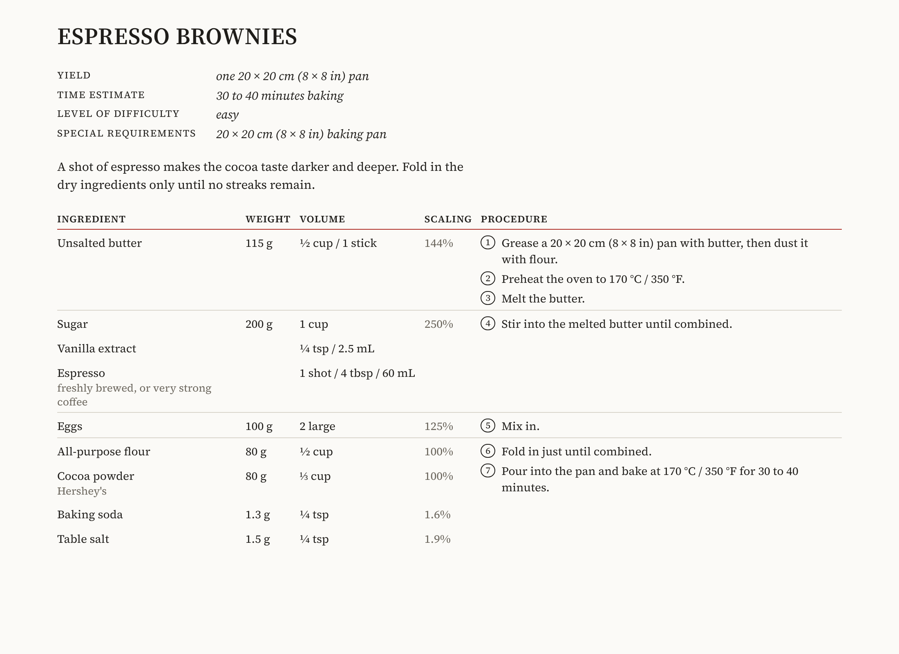
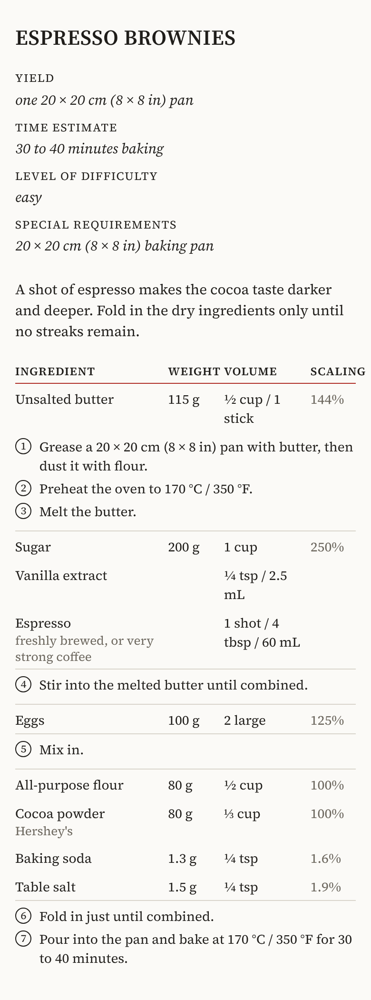

# algorithmic-recipe

Turn any recipe into a page you can actually cook from, and make it gluten-free or dairy-free on the way.

The plugin has four skills that work together:

| Skill | What it does |
| --- | --- |
| `/algorithmic-recipe` | A staircase table: ingredients in order of addition, each step spanning everything already in the bowl. |
| `/cookbook-recipe` | A classic cookbook page: metadata, intro, ingredients with weight, volume and scaling % beside numbered steps. |
| `/gluten-free-recipe` | Converts a recipe with gluten using Cris's rules, or swaps an unspecified gluten-free blend for her homemade one. |
| `/dairy-free-recipe` | Converts a recipe with dairy using Cris's rules. |

All four follow the same [shared rules](skills/_shared/recipe-rules.md): quantities stay in the source's units (only inches become centimetres), every tip and cue is kept, and pages print on landscape A4.

## Algorithmic layout

Ingredients are listed down the left in the order you add them. Each step sits to the right and stretches over everything already in the bowl, so you always see what is in the mixture and what comes next. Read it left to right like a program.


## Why it's useful

- **Mise en place in one glance.** The ingredient column is your prep list, already in the order you will need things.
- **Shopping list for free.** Everything with its quantity, in one column.
- **Quantities right where you need them.** Each step shows exactly which ingredients go into it, so there is no scrolling back and forth to the ingredient list while your hands are covered in batter.
- **Nothing lost in translation.** Every temperature, time, visual cue and "why" tip from the original is kept (reworded, not copied).
- **Works on a phone.** Light and dark mode, and the ingredient column stays pinned while the table scrolls sideways.

See the [full espresso brownies page](https://crisbarreiro.com/algorithmic-recipe/examples/espresso-brownies.html) behind the screenshot above (source in [`examples/espresso-brownies.html`](examples/espresso-brownies.html)).

## Cookbook layout

`/cookbook-recipe` lays a recipe out like a professional cookbook page: a metadata block (yield, time, storage, difficulty, special requirements), a short intro, then ingredients grouped by the step that adds them, with weight, volume and a scaling percentage beside the numbered steps. Variations and make-ahead notes follow. On a phone, each group stacks its ingredients with its steps underneath.

<p>


</p>

Source in [`examples/espresso-brownies-cookbook.html`](examples/espresso-brownies-cookbook.html).

## Gluten-free and dairy-free conversion

`/gluten-free-recipe` converts a recipe that contains gluten using the rules in [`skills/gluten-free-recipe/rules.md`](skills/gluten-free-recipe/rules.md). It picks the rule set for the type of bake (brownies, butter cakes, sponges, cookies, pastry, pancakes, cheesecake), swaps in the homemade gluten-free flour blend, adds xanthan gum, adjusts fat and liquids, and lists every change. It also runs on recipes that are already gluten-free but call for an unspecified blend, swapping in the homemade one. Bread and other yeasted doughs are never converted: they don't adapt reliably by rules. It returns the converted recipe as text, so you can render it next.

`/dairy-free-recipe` does the same for dairy with the rules in [`skills/dairy-free-recipe/rules.md`](skills/dairy-free-recipe/rules.md): plant milk, vegan butter, yogurt, buttermilk, cream and cream cheese swaps, plus the sugar and starch tweaks each bake needs. Chain them in this order:

```
/gluten-free-recipe https://example.com/my-favourite-brownies
/dairy-free-recipe
/cookbook-recipe
```

## Install

Ask your agent:

```
Install the algorithmic-recipe skill from https://github.com/CrisBarreiro/algorithmic-recipe, refer to the repo's AGENTS.md for instructions.
```

Or in Claude Code:

```bash
claude plugin marketplace add CrisBarreiro/algorithmic-recipe
claude plugin install algorithmic-recipe@algorithmic-recipe
```

See [INSTALL.md](INSTALL.md) for installing without the plugin system, on Claude.ai, and for updating or uninstalling.

## Usage

Invoke the skill and give it a recipe (pasted text, a URL or an attachment):

```
/algorithmic-recipe https://example.com/my-favourite-brownies
```

Claude also loads the skill on its own when you ask to "rewrite this recipe as an algorithmic recipe". The slash command just makes it explicit. The result is a single self-contained HTML page, saved wherever you ask.

## Repo layout

```
algorithmic-recipe/
├── README.md
├── INSTALL.md                every install route
├── AGENTS.md                 install guidance for agents
├── .claude-plugin/
│   ├── plugin.json           plugin manifest
│   └── marketplace.json      lets /plugin marketplace add point at this repo
├── skills/
│   ├── _shared/
│   │   └── recipe-rules.md   rules every recipe skill shares
│   ├── algorithmic-recipe/
│   │   └── SKILL.md          algorithmic staircase layout
│   ├── cookbook-recipe/
│   │   └── SKILL.md          separate cookbook-style layout
│   ├── gluten-free-recipe/
│   │   ├── SKILL.md          gluten-free conversion workflow
│   │   └── rules.md          gluten-free rules (source of truth)
│   └── dairy-free-recipe/
│       ├── SKILL.md          dairy-free conversion workflow
│       └── rules.md          dairy-free rules (source of truth)
├── examples/
│   ├── espresso-brownies.html
│   └── espresso-brownies-cookbook.html
└── assets/                   screenshots used in this README
    ├── espresso-brownies.png
    ├── espresso-brownies-cookbook.png
    └── espresso-brownies-cookbook-phone.png
```
