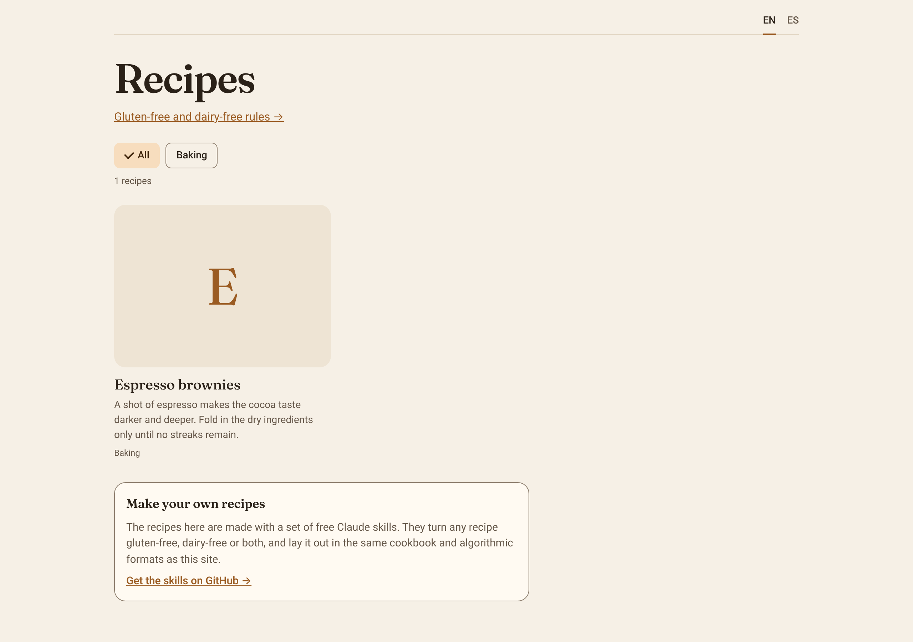

# Recipe site template

A small static site for your own recipes, made from the pages the `cookbook-recipe` and `algorithmic-recipe` skills write. It has an index with search and tag filters, both layouts for each recipe, English and Spanish, and a page of gluten-free and dairy-free rules. It's built to sit behind a login on Cloudflare Pages, out of search engines and AI crawlers.



Your own repo only holds your recipes and a few settings. This template does the rest, and you pull it in as an npm dependency.

## What your repo holds

```
recipes/
  espresso-brownies/
    en.html                English cookbook page (the default layout)
    en.algorithmic.html    English algorithmic page (optional)
    es.html                Spanish cookbook page (optional)
    es.algorithmic.html    Spanish algorithmic page (optional)
    photo.jpg              optional, shared by both languages (about 1200 px wide)
    recipe.json            optional: {"tags": [...], "notes": {"en": [...], "es": [...]}}
functions/_middleware.js   the login token check (one line, below)
package.json
site.config.json           optional settings (below)
```

`package.json`:

```json
{
  "private": true,
  "type": "module",
  "scripts": {
    "build": "recipe-site && pagefind --site dist",
    "preview": "npm run build && npx --yes serve@14.2.4 dist"
  },
  "devDependencies": {
    "baking-plugin": "github:CrisBarreiro/baking-plugin#main",
    "pagefind": "1.3.0"
  }
}
```

`functions/_middleware.js`:

```js
export { onRequest } from "baking-plugin/site-template/functions/_middleware.js";
```

`npm install` pins the template to the commit it fetched, in `package-lock.json`. To take a newer version, run `npm install github:CrisBarreiro/baking-plugin#main` and commit the lockfile.

The `example/` folder here is a working site with one recipe: `npm run example` from the repo root builds it into `example/dist/`.

## Recipes

- Pages are the HTML the recipe skills produce. The build wraps them in a full page with the site header, language switch and `noindex` tags, and styles them with the Paper design (`design/`).
- A recipe in only one language still shows on both index pages, marked "Only in English" or "Solo en español".
- **Tags** come from `recipe.json` and are translated in `assets/i18n.json`. Add a new tag's names in `site.config.json`.
- **My notes**: your notes from baking it (what went wrong, what to try next) go in `recipe.json` under `notes`, one list per language. They show in a box above the table in both layouts. A language without notes shows the other language's.

## Settings

Everything here is optional.

| File in your repo | What it does |
| --- | --- |
| `site.config.json` | `"i18n"`: overrides for `assets/i18n.json`, merged key by key, such as a `host` per language or new tag names. `"rules": false` turns off the rules page, and `"skillsBox": false` the box linking here from the index. |
| `rules.json` | Replaces the rules page content (`assets/rules.json`, the same rules as the `gluten-free-recipe` and `dairy-free-recipe` skills). |
| `site.css` | Added after the template's CSS. |
| `brand/` | Files that replace the icons and login page logo in `assets/brand/` with the same name. |
| `robots.txt`, `_headers` | Replace the template's, which block every crawler and send `noindex` headers. |

```json
{
  "i18n": {
    "en": { "host": "recipes.example.com", "tags": { "bread": "Bread" } },
    "es": { "host": "recetas.example.com", "tags": { "bread": "Pan" } }
  }
}
```

With a `host` per language, each language lives on its own address and the EN / ES switch jumps between them. On any other address (like the `*.pages.dev` one) everything works from one host.

An `entry` per language (such as `"entry": "recetas.example.com"`) is for a public entry page hosted off Cloudflare that shows the site in a frame, so the site keeps the entry address and the entry page can explain when Cloudflare is unreachable. Framed, every page sends the entry page its path and title (`postMessage`, only to the `entry` origins), and links to other sites open in a new tab. `/session.svg` is a small image behind Access that the entry page loads to tell whether the visitor is logged in; if not, it sets a short-lived `recipes_entry=1` cookie on the shared parent domain (or adds `?entry=1`) and opens the site as a full page for the login, and the site clears it and sends the visitor back to the entry address afterwards. The `_headers` `frame-ancestors` rule must list the entry hosts.

## Addresses

| Address | What it is |
| --- | --- |
| `/` | Sends you to `/en/` or `/es/` (last language used, else the browser's language) |
| `/en/`, `/es/` | Recipe index with search and tag filters |
| `/en/<id>/` | One recipe, cookbook layout |
| `/en/<id>/algorithmic/` | The same recipe in the algorithmic layout |
| `/en/rules/` | Gluten-free and dairy-free rules, linked from the index |

Search uses [Pagefind](https://pagefind.app), with a separate index per language.

## Putting it online, privately

1. **Cloudflare Pages:** create a project from your repo. Framework preset None, build command `npm run build`, output directory `dist`.
2. **Cloudflare Access:** in Zero Trust, add a self-hosted application for each address of the site, with a policy that allows only your own emails (one-time PIN login). Add a second application of type Bypass for the path `/brand`, so the login page can show your logo.
3. **The token check:** under the Pages project's Settings → Variables and secrets, add (Production, Text) `ACCESS_TEAM_DOMAIN`, your team domain (`<team>.cloudflareaccess.com`), and `ACCESS_AUD`, the Application Audience (AUD) tag of each Access application, comma-separated. Then retry the deployment. The default headers allow the site to be embedded only by the public `recipes.crisbarreiro.com` and `recetas.crisbarreiro.com` entry hosts.

`functions/_middleware.js` runs before every file is served and only lets a request through with a valid Access login token: signed by your team, not expired, and issued for one of your applications. Anything else gets a 403 that says which check failed. If either variable is missing it refuses everything. `/brand/` is the only path served without a token. Neither value is a secret: the check relies on Cloudflare's signing key.

## What's in here

| Path | What it is |
| --- | --- |
| `build.mjs` | The build (`recipe-site`). Reads `recipes/` from the folder it runs in and writes `dist/` there. |
| `design/` | Paper, the design system: `tokens.css` and `components.css`, documented in `design/README.md`. |
| `assets/` | Defaults: interface labels in both languages, rules page content, site CSS, icons, `robots.txt` and `_headers`. |
| `functions/_middleware.js` | The Cloudflare Access token check. |
| `example/` | A one-recipe site to try it on. |
