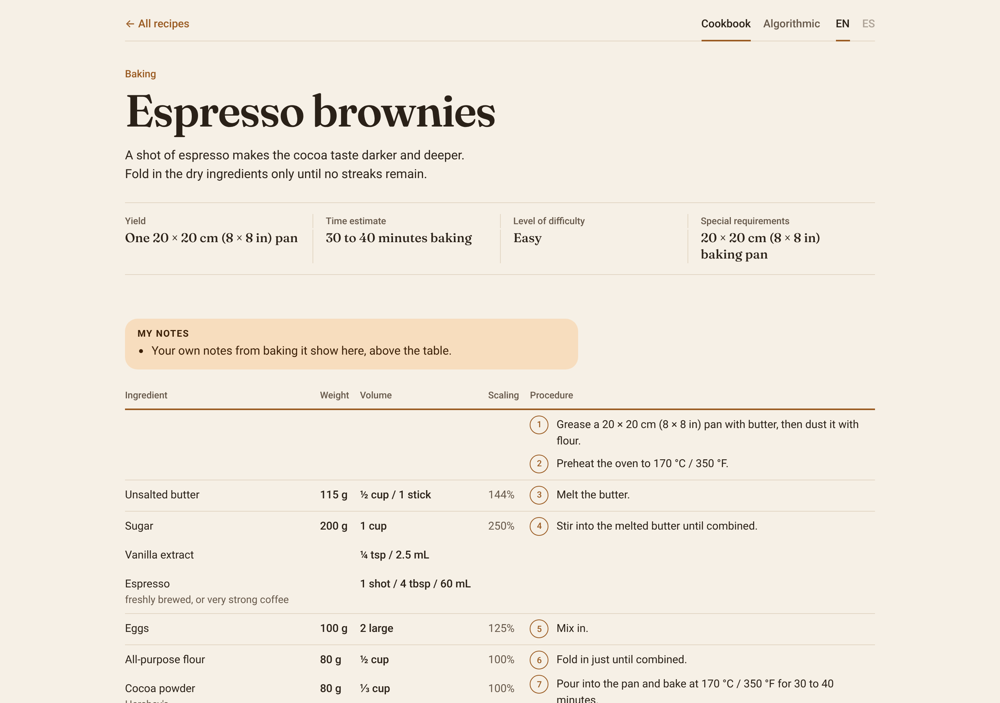
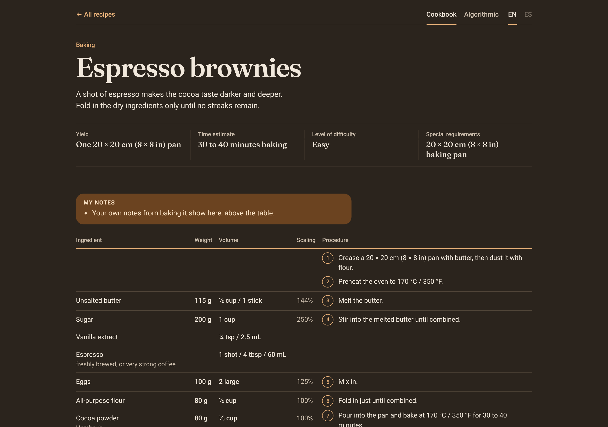
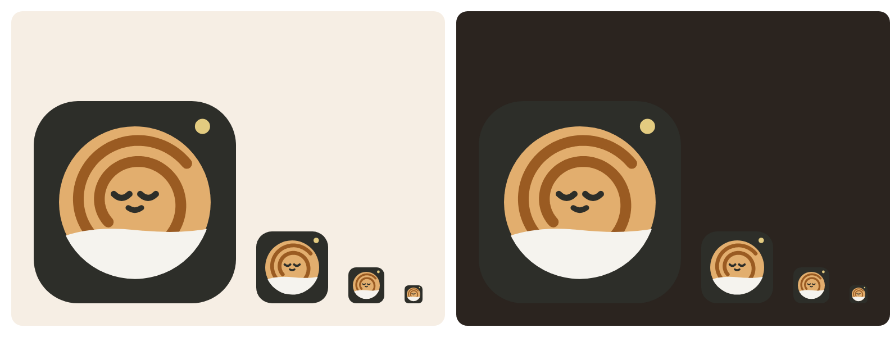
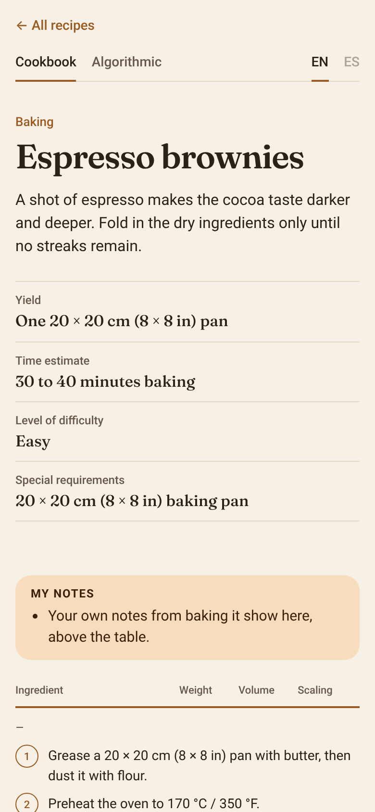

# Paper

The look of the recipe site, kept apart from the site so another project can use it. It's
[Pillbox](https://github.com/CrisBarreiro/Pillbox)'s "Calm & crafted" style moved to the web, in a caramel
palette for baking: oat paper, a toffee brown accent, a toasted brown dark mode, Fraunces for titles and Roboto
for text.

| File | What it is |
| --- | --- |
| `tokens.css` | Colours (light, dark and print), type, space and shape, as CSS variables. Needs nothing else. |
| `components.css` | The components below, built only from the tokens. Needs `tokens.css` first. |




## Using it elsewhere

Copy both files (they have no build step and no dependencies), load the fonts, and give `<body>` the class
`paper`:

```html
<link rel="stylesheet" href="https://fonts.googleapis.com/css2?family=Fraunces:opsz,wght@9..144,500;9..144,600&family=Roboto:wght@400;500;700&display=swap">
<link rel="stylesheet" href="tokens.css">
<link rel="stylesheet" href="components.css">
<body class="paper">
```

Dark mode follows the system, and `data-theme="light"` or `"dark"` on `<html>` overrides it either way.
Print is always light. To use only the colours, take `tokens.css` alone.

## Tokens

| Token | Light | Dark | Use |
| --- | --- | --- | --- |
| `--paper` | `#F6F0E6` | `#2B241D` | Page |
| `--card` | `#FFFAF2` | `#3A3129` | A surface a step off the page (search box, algorithmic cells) |
| `--card-2` | `#EEE4D4` | `#332B23` | A quieter fill (photo placeholders, sticky column) |
| `--ink` | `#2A2118` | `#F1E8DC` | Text |
| `--muted` | `#66584A` | `#CDBFAE` | Secondary text, labels |
| `--outline` | `#8F8070` | `#9C8E7D` | Borders of controls |
| `--rule` | `#E3D7C5` | `#4D4236` | Hairlines |
| `--accent` | `#9A5B22` | `#E9B27A` | Caramel: links, current tab, step numbers, eyebrows |
| `--on-accent` | `#FFFFFF` | `#4A2805` | Text on a filled accent |
| `--accent-soft` | `#F7DDBE` | `#6B4320` | A selected chip |
| `--on-accent-soft` | `#3A1F06` | `#FBE3C6` | Text on `--accent-soft` |

Type: `--font-display` (Fraunces, for titles and the facts strip), `--font-body` (Roboto), sizes `--text-xs`
12px to `--text-l` 16px and `--title-s`, `--title-m`, `--title-l`. Space: `--space-1` to `--space-6`
(4, 8, 12, 16, 24, 32px). Shape: `--radius-s` 8px, `--radius-m` 16px, `--radius-pill`. Width:
`--measure` 65ch, `--page-width` 960px. Labels are in sentence case, never uppercase.

The layout, type and shapes come from Pillbox (`ui/theme/Theme.kt`); the colours are its own for baking.
Every accent passes 4.5:1 contrast on the page in both themes.

## Icon

A cinnamon roll seen from above, asleep, in the family of Cris's Pillbox and Stronk icons: on their Dusk
background (`#2D2E29`), flat shapes with no outlines, a character with closed eyes and a small smile, tucked in,
with one small light. The roll is golden (`#E2AE6E`) with a caramel swirl (`--accent`, `#9A5B22`) that starts
low on the left and winds round the face, and cream icing (`#F5F3EE`) pulled up over it like a duvet. One drawing at
every size, in `assets/brand/`: `logo.svg` and `logo.png` (512px, the login page), `icon.svg` and `icon-32.png` (the
favicon), and `apple-touch-icon.png` (180px, square corners, since phones round them).



## Components

### Bar

A back link and tab groups on a hairline. The current tab is underlined in the accent.

```html
<header class="bar">
  <a class="bar-back" href="/en/">All recipes</a>
  <nav class="tabs"><span aria-current="true">Cookbook</span><a href="algorithmic/">Algorithmic</a></nav>
  <nav class="tabs"><span aria-current="true">EN</span><a href="/es/…">ES</a></nav>
</header>
```

`span.bar-spacer` stands in for the back link on a page with none. A tab that can't be picked is
`<span class="off" title="why">`. Set `--bar-width` on a parent for a wider page.

### Eyebrow, photo

`<p class="eyebrow">Breakfast · Gluten-free</p>` is a short caramel line above a title.
`` is a 4:3 photo with rounded corners.

### Chips

Filters you switch on and off; the one that's on is filled and ticked.

```html
<div class="chips" role="group"><button type="button" aria-pressed="true">All</button><button type="button" aria-pressed="false">Baking</button></div>
```

### Cards

A grid of links with a photo, set on the page rather than in boxes.

```html
<ul class="cards"><li><a href="…">
              <!-- or <span class="nophoto">B</span> -->
  <span class="title">Brown butter blondies</span>
  <span class="note">Only in Spanish</span>    <!-- optional -->
  <span class="intro">…</span>
  <span class="tags"><span>Baking</span><span>Gluten-free</span></span>
</a></li></ul>
```

### Recipe

The page the `cookbook-recipe` skill writes (from
[algorithmic-recipe](https://github.com/CrisBarreiro/algorithmic-recipe)), styled by its own class names, so
the skill's `<main>` only needs `class="recipe"` (and `has-photo` when it has a photo) and its own
`<style>` taken out. It lays out:

- `img.photo` and `p.eyebrow`, added first inside `<main>`; with a photo, the photo sits beside the title
  and intro on wide screens and above them on a phone.
- `h1`, `p.src` and `div.intro`, then `dl.meta` as a strip of facts split by hairlines, each label over its
  value in Fraunces (stacked on a phone).
- The staircase table: `td.ing` (with `span.prep`), `td.w`, `td.v`, `td.s`, and `td.proc` holding an
  `ol` of steps, each with an outlined caramel number `span.n` and an optional `span.tip`. One `<tbody>` per
  group. Below 640px each group stacks its ingredients, then its steps.
- `p.base`, then `div.notes` with one `<section>` per note (`h2` and `div.note`, variations as
  `div.var > p.vn + p`), side by side when there's room.

It prints on landscape A4 in light colours, with no photo or bar, running onto a second sheet only when
the recipe needs it.


