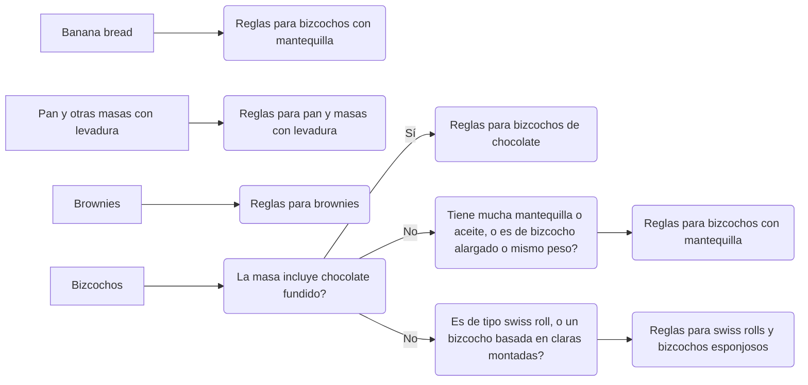

# Reglas

Cris's own conversion rules, copied verbatim from her Notion page ("Reglas"). They are the only source of truth for `gluten-free-recipe`: change them here, not in `SKILL.md`.

## Qué reglas usar

## Mezcla casera de harina sin gluten

### Ingredientes para 1kg

Marcados con ⭐ los que usa The Loopy Whisk

- 500g de harina almidonada
    - Harina de arrurruz , Maizena , Almidón de patata , ⭐ Almidón de tapioca
- 250g de harina proteica "ligera"
    - Harina de arroz integral super fina, o ⭐ Harina de mijo
- 250g de harina proteica "pesada"
    - Harina de trigo sarraceno , Harina de avena , ⭐ Harina de sorgo , o Harina de teff

### La que uso yo

Maizena (almidón), harina de arroz integral (proteica ligera) y harina de avena sin gluten (proteica pesada).

# Reglas para bizcochos con mantequilla

## Sin gluten

1. Usa una Mezcla casera de harina sin gluten y reduce la cantidad de harina en un 10%
2. **Para bizcochos y cupcakes:** Añade 1/4 de cdta de goma xantana por cada 120g de mezcla de harinas
3. **Para muffins:** Añade 1/2 cdta de goma xantana por cada 120g de mezcla de harinas

## Sin lácteos

1. Cambia la leche por el mismo peso o volumen de bebida vegetal (almendra, arroz, soja o avena). No uses leche de coco en lata
2. Cambia la mantequilla por el mismo peso o volumen de Mantequilla vegana . O reemplaza el peso de la mantequilla por un 80% de aceite de girasol y un 15% de bebida vegetal
3. Reemplaza el yogur o sour cream por el mismo peso o volumen de yogur vegetal sin sabor ni azúcar añadido
4. Reemplaza la buttermilk for Buttermilk vegana

# Reglas para pan y masas con levadura

> **Pendiente.** This rule set has not been added yet. The skill does not convert bread or yeasted doughs until it is.

# Reglas para brownies

## Sin gluten

1. Usa una Mezcla casera de harina sin gluten y usa la misma cantidad
2. Añade 1/4 de cdta de goma xantana por cada 120g de mezcla de harinas
    1. Si estás usando una base sin huevo o vegana, añade 1/2 cdta de goma xantana por cada 120g de mezcla de harinas en su lugar, y reduce la cantidad de grasa (mantequilla) en un 30%

## Sin lácteos

1. Cambia la leche por el mismo peso o volumen de bebida vegetal (almendra, arroz, soja o avena). No uses leche de coco en lata
2. Cambia la mantequilla por el mismo peso o volumen de Mantequilla vegana

# Reglas para bizcochos de chocolate con chocolate derretido en la masa

## Sin gluten

1. Usa una Mezcla casera de harina sin gluten y reduce la cantidad de harina en un 10%
2. Añade 1/2 de cdta de goma xantana por cada 120g de mezcla de harinas
    1. Si estás usando una base sin huevo o vegana, añade 1cdta de goma xantana por cada 120g de mezcla de harinas

## Sin lácteos

1. Cambia la leche por el mismo peso o volumen de bebida vegetal (almendra, arroz, soja o avena). No uses leche de coco en lata
2. Cambia la mantequilla por el mismo peso o volumen de Mantequilla vegana . O reemplaza el peso de la mantequilla por un 80% de aceite de girasol y un 15% de bebida vegetal
3. Reemplaza el yogur o sour cream por el mismo peso o volumen de yogur vegetal sin sabor ni azúcar añadido
4. Reemplaza la buttermilk for Buttermilk vegana

# Reglas para swiss rolls y bizcochos esponjosos

## Sin gluten

1. Usa una Mezcla casera de harina sin gluten y reduce la cantidad de harina en un 10%
2. Añade 3/4 de cdta de goma xantana por cada 120g de mezcla de harinas
    1. Si estás usando una base vegana sin frutos secos o cacao en polvo en la masa, añade 20g de harina de almendra o semilla de girasol molida por cada 120g de harina sin gluten.

## Sin lácteos

1. Cambia la leche por el mismo peso o volumen de bebida vegetal (almendra, arroz, soja o avena). No uses leche de coco en lata
2. Cambia la mantequilla por el mismo peso o volumen de Mantequilla vegana . O reemplaza el peso de la mantequilla por un 80% de aceite de girasol
3. Reemplaza el yogur o sour cream por el mismo peso o volumen de yogur vegetal sin sabor ni azúcar añadido
4. Reemplaza la buttermilk for Buttermilk vegana

# Reglas para cookies que mantienen la forma al hornear

## Sin gluten

1. Usa la misma cantidad Mezcla casera de harina sin gluten
2. Añade 1/4 de cdta de goma xantana por cada 120g de mezcla de harinas
3. Reduce la cantidad de mantequilla en un 20%

## Sin lácteos

1. Cambia la leche por el mismo peso o volumen de bebida vegetal (almendra, arroz, soja o avena). No uses leche de coco en lata
2. Cambia la mantequilla por el mismo peso o volumen de Mantequilla vegana

# Reglas para cookies que se expanden al hornear

## Sin gluten

1. Usa la misma cantidad de Mezcla casera de harina sin gluten
2. Reduce la cantidad de mantequilla en un 30%. Úsala a temperatura ambiente, no fundida
3. Añade 1/4 de cdta de goma xantana por cada 120g de mezcla de harinas

## Sin lácteos

1. Cambia la mantequilla por el mismo peso o volumen de Mantequilla vegana

# Reglas para adaptar galletas tipo bizcocho

## Sin gluten

1. Usa una Mezcla casera de harina sin gluten y reduce la cantidad de harina en un 10%
2. Añade 1/4 de cdta de goma xantana por cada 120g de mezcla de harinas
    1. Si estás usando una base sin huevo o vegana, añade 1/2 cdta de goma xantana por cada 120g de mezcla de harinas en su lugar

## Sin lácteos

1. Cambia la leche por el mismo peso o volumen de bebida vegetal (almendra, arroz, soja o avena). No uses leche de coco en lata
2. Cambia la mantequilla por el mismo peso o volumen de Mantequilla vegana
3. Reemplaza el yogur o sour cream por el mismo peso o volumen de yogur vegetal sin sabor ni azúcar añadido
4. Reemplaza la buttermilk for Buttermilk vegana

# Reglas para adaptar masa quebrada

## Sin gluten

1. Usa la misma cantidad de Mezcla casera de harina sin gluten
2. Añade 1/2 de cdta de goma xantana por cada 120g de mezcla de harinas
3. Reduce la cantidad de mantequilla en un 20%
4. Si partes de una base vegana, añade 1/4 cdta de Royal y 20g de harina de almendra o semillas de girasol molidas por cada 120 de harina sin gluten. Añade la bebida vegetal lentamente hasta que se forme la pasta (necesitarás un 40% menos de bebida vegetal que en la versión con gluten)

## Sin lácteos

1. Cambia la mantequilla por el mismo peso o volumen de Mantequilla vegana
2. Cambia un 20% de la harina por el mismo peso de almidón (maizena, almidón de patata, almidón de tapioca, o almidón de arruruz)

# Reglas para masas hojaldradas

## Sin gluten

1. Usa una Mezcla casera de harina sin gluten y reduce la cantidad de harina en un 10%
2. Añade 1/2 de cdta de goma xantana por cada 120g de mezcla de harinas
3. Aumenta la cantidad de agua en un 20%
4. Si estás empezando con una base vegana, usa una mezcla 50:50 de margarina y Mantequilla vegana. Mezcla la mantequilla vegana con los ingredientes secos hasta que tengas trozos del tamaño de un guisante, y usa el agua que necesites hasta que la masa se forme (Necesitarás un 10% menos que en la versión vegana con gluten)

## Sin lácteos

1. Cambia la leche por el mismo peso o volumen de bebida vegetal (almendra, arroz, soja o avena). No uses leche de coco en lata
2. Cambia la mantequilla por el mismo peso o volumen de Mantequilla vegana . O reemplaza el peso de la mantequilla por un 80% de aceite de girasol y un 15% de bebida vegetal
3. Reemplaza el yogur o sour cream por el mismo peso o volumen de yogur vegetal sin sabor ni azúcar añadido
4. Reemplaza la buttermilk for Buttermilk vegana

# Reglas para tortitas gruesas

## Sin gluten

1. Usa una Mezcla casera de harina sin gluten y reduce la cantidad de harina en un 10%
2. Añade 1/4 de cdta de goma xantana por cada 120g de mezcla de harinas
3. Si partes de una base vegana, sustituye un 25% de la bebida vegetal por el mismo peso de Leche condensada vegana, y reduce la cantidad de azúcar a la mitad.

## Sin lácteos

1. Cambia la mantequilla por el mismo peso o volumen de Mantequilla vegana . O reemplaza el peso de la mantequilla por un 80% de aceite de girasol y un 15% de bebida vegetal
2. Cambia la leche por el mismo peso o volumen de bebida vegetal (almendra, arroz, soja o avena). No uses leche de coco en lata
3. Aumenta la cantidad de azúcar en 5-10g por cada 240g de bebida vegetal

# Reglas para tortitas esponjosas

## Sin gluten

1. Usa una Mezcla casera de harina sin gluten y reduce la cantidad de harina en un 10%
2. Añade 1/2 de cdta de goma xantana por cada 120g de mezcla de harinas. Si usas un líquido espeso, como buttermilk, usa solo 1/4 cdta de goma xantana por cada 120g de mezcla de harinas
3. Si partes de una base vegana, añade 20g de harina de almendra o semillas de girasol molidas por cada 120g de harina sin gluten

## Sin lácteos

1. Cambia la mantequilla por el mismo peso o volumen de Mantequilla vegana . O reemplaza el peso de la mantequilla por un 80% de aceite de girasol y un 15% de bebida vegetal
2. Cambia la leche por el mismo peso o volumen de bebida vegetal (almendra, arroz, soja o avena). No uses leche de coco en lata
3. Cambia la buttermilk por el mismo peso o volumen de Buttermilk vegana
4. Aumenta la cantidad de azúcar en 10g por cada 240g de bebida vegetal

# Reglas para tartas de queso al horno

## Sin gluten

1. Usa la misma cantidad de galleta sin gluten para la base

## Sin lácteos

1. Cambia la mantequilla por el mismo peso o volumen de Mantequilla vegana
2. Cambia el queso crema por el mismo peso o volumen de queso crema vegano con bajo contenido en agua y textura similar al queso crema. Si es demasiado líquido, usa una gasa para queso
3. Cambia el yogur por el mismo peso de yogur griego vegano
4. Cambia la nata por la misma cantidad de nata vegana
5. Añade 5g de maizena por cada 225g de queso crema
6. Si la receta contiene nata para montar, añade 10g de maizena por cada 230g de nata
