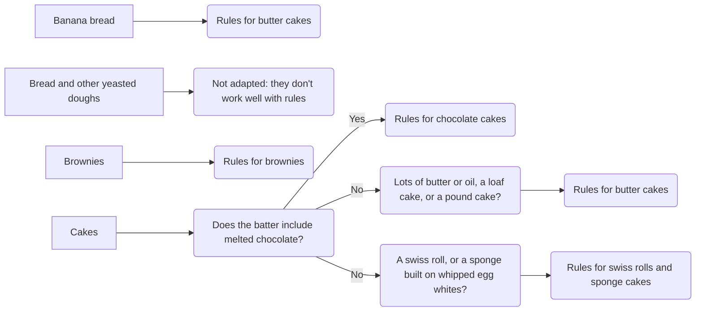

# Gluten-free rules

Cris's own gluten-free conversion rules, translated from her Notion page ("Reglas"). `SKILL.md` reads this file before every conversion, and it is the only source for ratios: change rules here, not in `SKILL.md`. The dairy-free rules from the same page live in the separate `dairy-free-recipe` skill.

"tsp" is a teaspoon. "Flour blend" is the homemade gluten-free flour blend below.

## Which rules to use

## Homemade gluten-free flour blend

### Ingredients for 1 kg

Marked with ⭐: the ones The Loopy Whisk uses.

- 500 g starch
    - Arrowroot, cornstarch, potato starch, ⭐ tapioca starch
- 250 g "light" protein flour
    - Superfine brown rice flour, or ⭐ millet flour
- 250 g "heavy" protein flour
    - Buckwheat flour, oat flour, ⭐ sorghum flour, or teff flour

### The one I use

Cornstarch (starch), brown rice flour (light protein flour) and gluten-free oat flour (heavy protein flour).

## Butter cakes

1. Use the flour blend and reduce the amount of flour by 10%.
2. **For cakes and cupcakes:** add ¼ tsp xanthan gum per 120 g of flour blend.
3. **For muffins:** add ½ tsp xanthan gum per 120 g of flour blend.

## Brownies

1. Use the same amount of flour blend.
2. Add ¼ tsp xanthan gum per 120 g of flour blend.
    1. If you are starting from an egg-free or vegan base, add ½ tsp xanthan gum per 120 g of flour blend instead, and reduce the fat (butter) by 30%.

## Chocolate cakes with melted chocolate in the batter

1. Use the flour blend and reduce the amount of flour by 10%.
2. Add ½ tsp xanthan gum per 120 g of flour blend.
    1. If you are starting from an egg-free or vegan base, add 1 tsp xanthan gum per 120 g of flour blend.

## Swiss rolls and sponge cakes

1. Use the flour blend and reduce the amount of flour by 10%.
2. Add ¾ tsp xanthan gum per 120 g of flour blend.
    1. If you are starting from a vegan base with no nuts or cocoa powder in the batter, add 20 g almond flour or ground sunflower seeds per 120 g of flour blend.

## Cookies that hold their shape when baked

1. Use the same amount of flour blend.
2. Add ¼ tsp xanthan gum per 120 g of flour blend.
3. Reduce the butter by 20%.

## Cookies that spread when baked

1. Use the same amount of flour blend.
2. Reduce the butter by 30%. Use it at room temperature, not melted.
3. Add ¼ tsp xanthan gum per 120 g of flour blend.

## Cake-like cookies

1. Use the flour blend and reduce the amount of flour by 10%.
2. Add ¼ tsp xanthan gum per 120 g of flour blend.
    1. If you are starting from an egg-free or vegan base, add ½ tsp xanthan gum per 120 g of flour blend instead.

## Shortcrust pastry

1. Use the same amount of flour blend.
2. Add ½ tsp xanthan gum per 120 g of flour blend.
3. Reduce the butter by 20%.
4. If you are starting from a vegan base, add ¼ tsp baking powder and 20 g almond flour or ground sunflower seeds per 120 g of flour blend. Add the plant milk slowly until the dough comes together (you will need 40% less plant milk than in the version with gluten).

## Puff and flaky pastry

1. Use the flour blend and reduce the amount of flour by 10%.
2. Add ½ tsp xanthan gum per 120 g of flour blend.
3. Increase the water by 20%.
4. If you are starting from a vegan base, use a 50:50 mix of margarine and vegan butter. Rub the vegan butter into the dry ingredients until you have pea-sized pieces, and add only as much water as the dough needs to come together (you will need 10% less than in the vegan version with gluten).

## Thick pancakes

1. Use the flour blend and reduce the amount of flour by 10%.
2. Add ¼ tsp xanthan gum per 120 g of flour blend.
3. If you are starting from a vegan base, replace 25% of the plant milk with the same weight of vegan condensed milk, and halve the sugar.

## Fluffy pancakes

1. Use the flour blend and reduce the amount of flour by 10%.
2. Add ½ tsp xanthan gum per 120 g of flour blend. If you use a thick liquid such as buttermilk, use only ¼ tsp xanthan gum per 120 g of flour blend.
3. If you are starting from a vegan base, add 20 g almond flour or ground sunflower seeds per 120 g of flour blend.

## Baked cheesecake

1. Use the same amount of gluten-free biscuits for the base.
